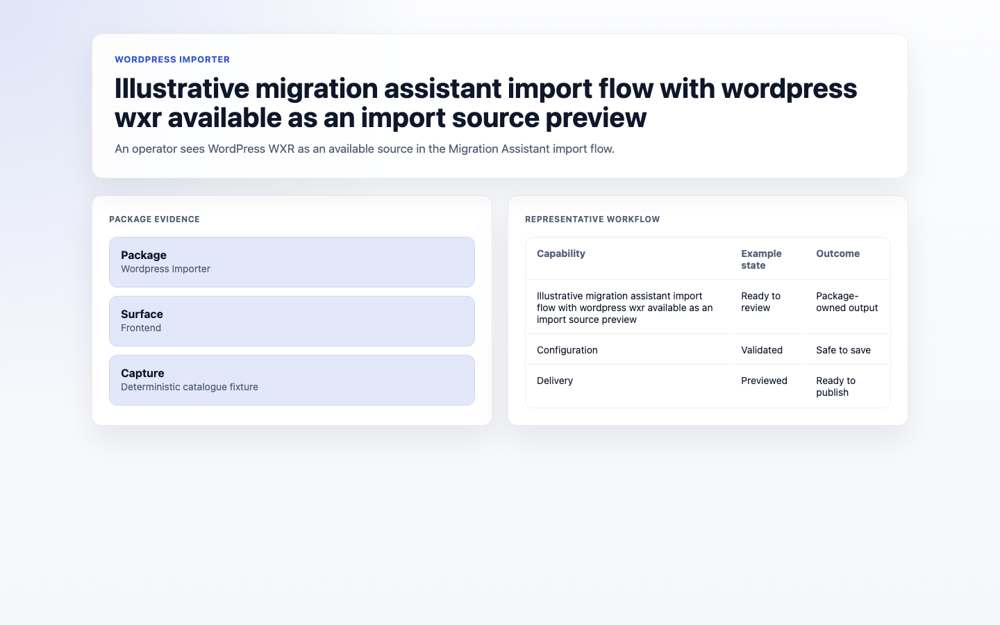
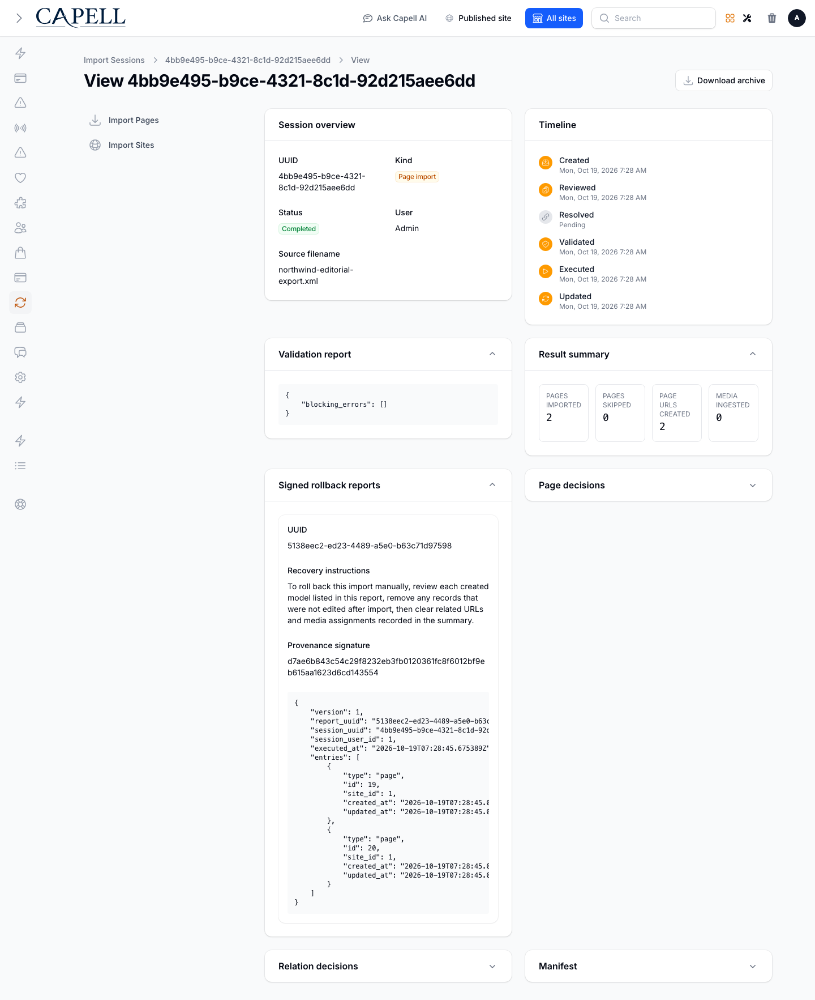

# WordPress Importer

<!-- prettier-ignore-start -->

Hand over a client's WordPress export file and the posts and pages in it arrive with their images as ordinary pages on the new site, built with Capell. An agency or developer runs the import from the command line.

The preview writes nothing and counts what would be created, skipped or rejected. Posts already imported anywhere on the site are skipped, so a repeat run of the same export won't create copies. If Redirects is installed too, each post's old address leads to its new page, and any post that can't get one is listed with the reason.

Only posts WordPress had published keep their date. Everything else arrives unpublished, with its WordPress status noted. Comments and users stay behind, as do revisions and custom post types. Shortcodes are taken out. Text between a shortcode's opening and closing tags stays as plain text, and stand-alone ones such as galleries or forms disappear. Bracketed words such as [sic] or [note] standing alone go too. The original content stays in the page's details.

Images come from public addresses only, and files over 50 MB are refused. If a download fails, retrying the import picks up where it stopped without duplicating anything. Each image that arrives is stored on the new site, and the page's text is updated to point at that copy.

- **Price and availability:** Check current availability and price on the [Capell Marketplace listing](https://capell.app/extensions/wordpress-importer).
- **Licence:** Check the licence terms on the [Capell Marketplace listing](https://capell.app/extensions/wordpress-importer).
- **Requires:** `PHP ^8.4`, `capell-app/admin ^1.0`, `capell-app/core ^1.0.75`, `capell-app/migration-assistant ^1.0`, `illuminate/support ^11.0|^12.0|^13.0`, `spatie/laravel-package-tools ^1.15`.
- **Install:** `composer require capell-app/wordpress-importer`.

## Quick Start

1. Install the package: `composer require capell-app/wordpress-importer`.
2. Open the package admin surface at `/admin/migration-assistant/import-sessions` and confirm WordPress Importer is available.

## For Developers

WXR parsing, preview construction, execution, media import, and redirect creation are separated into testable services and Actions.

## Configure

- **Configuration files:** `config/wordpress-importer.php`.
- **Commands:** `php artisan wordpress-importer:import`.

## Limits And Pitfalls

- Install the required Capell packages at the versions in `composer.json`: `capell-app/admin ^1.0`, `capell-app/core ^1.0.75`, `capell-app/migration-assistant ^1.0`.

## Screens And Workflow

- Illustrative migration assistant import flow with wordpress wxr available as an import source preview (frontend).
- Import session detail for a WordPress WXR import (admin).
- Completed WordPress import report (frontend).
- WordPress import validation errors (frontend).
- WordPress import rollback state (frontend).

## Install Impact

- Required packages: `capell-app/admin`, `capell-app/core`, `capell-app/migration-assistant`.
- Admin navigation: no admin page or resource contribution is declared.
- Admin/editor extensions: none declared.
- Permissions: no package permission declarations or Shield gates detected; host access rules still apply.
- Public routes: none declared.
- Database changes: no package migrations declared.
- Config: `config/wordpress-importer.php`.
- Settings: no package settings declared.
- Queues or schedules: none declared.
- Cache tags: none declared.
- Commands: `wordpress-importer:import`.

## Troubleshooting

| Symptom | Likely cause | Check | Fix |
| --- | --- | --- | --- |
| Package surface is missing after install | Provider or manifest is not loaded | Confirm `capell.json`, package `composer.json`, and provider registration | Reinstall the package, refresh Composer autoload, and clear host caches |

## Upgrading

No manual steps between minor versions.

Read [CHANGELOG.md](CHANGELOG.md) before upgrading.

## Next Steps

- [Package docs](docs/README.md)
- [Overview](docs/overview.md)
- [Worked extension examples](docs/extension-contracts.md)
- [Admin guide](docs/admin-guide.md)
- Configuration files: [`config/wordpress-importer.php`](config/wordpress-importer.php).
- [Troubleshooting](#troubleshooting)
- [Developer reference](docs/reference.md)
- [Marketplace assets](docs/assets/marketplace/)
- [Capell content language plan](../../docs/CONTENT_LANGUAGE_PLAN.md)
- [Capell documentation design system](../../docs/DESIGN_SYSTEM.md)
- [Capell and package ERD notes](../../docs/erd/capell-and-package-erds.md)
- Related packages: [Migration Assistant](../migration-assistant/README.md), [Redirects](../url-manager/README.md), [SEO Checks](../seo-suite/README.md).

<!-- prettier-ignore-end -->
