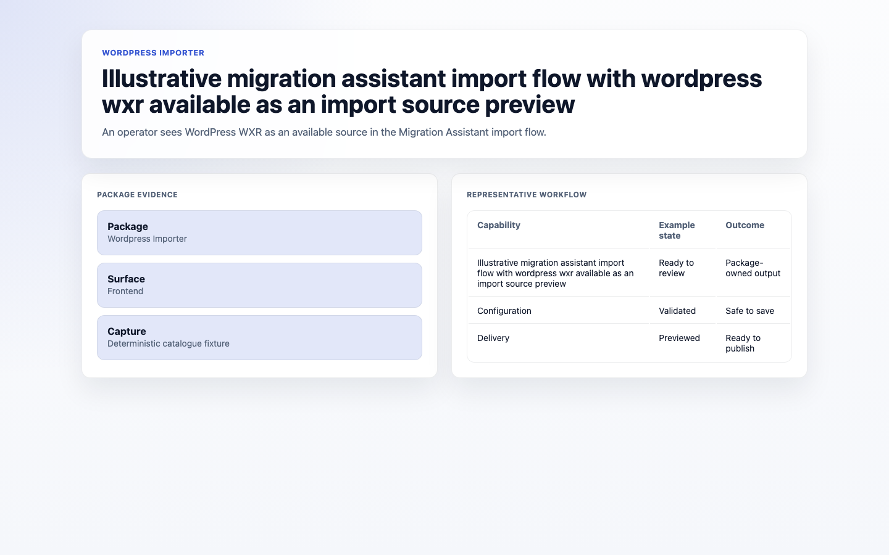
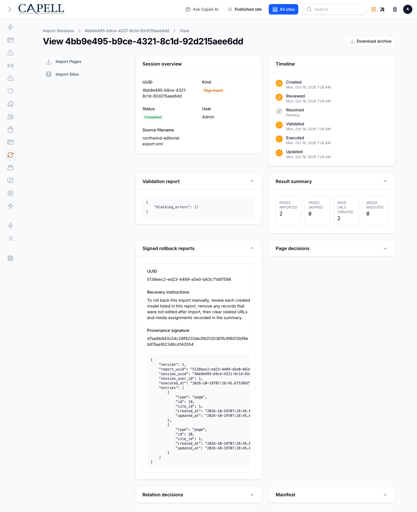

# WordPress Importer

<!-- prettier-ignore-start -->

## What It Does

WordPress Importer reads WXR exports, builds an import preview, and imports WordPress content, authors, taxonomies, media references, and source metadata through Migration Assistant. It can also create old-permalink redirects when the URL Manager integration is available.

- **Price and availability:** Check current availability and price on the [Capell Marketplace listing](https://capell.app/extensions/wordpress-importer).
- **Licence:** Check the licence terms on the [Capell Marketplace listing](https://capell.app/extensions/wordpress-importer).
- **Requires:** `PHP ^8.4`, `capell-app/admin ^1.0`, `capell-app/core ^1.0.75`, `capell-app/migration-assistant ^1.0`, `illuminate/support ^11.0|^12.0|^13.0`, `spatie/laravel-package-tools ^1.15`.
- **Install:** `composer require capell-app/wordpress-importer`.

Operators can preview a WXR migration and run it from the package command, including supported media and permalink handling.

## Who It Is For

**For developers:** WXR parsing, preview construction, execution, media import, and redirect creation are separated into testable services and Actions.

**For teams:** Migration teams can inspect the proposed move before execution and retain important source relationships and legacy URLs during the transition.

## Quick Start

1. Install the package: `composer require capell-app/wordpress-importer`.
2. Open the package admin surface at `/admin/migration-assistant/import-sessions` and confirm WordPress Importer is available.

## Configure

- **Configuration files:** `config/wordpress-importer.php`.
- **Commands:** `php artisan wordpress-importer:import`.

## Limits And Pitfalls

- Install the required Capell packages at the versions in `composer.json`: `capell-app/admin ^1.0`, `capell-app/core ^1.0.75`, `capell-app/migration-assistant ^1.0`.

## Screens And Workflow

- Illustrative migration assistant import flow with wordpress wxr available as an import source preview (frontend).
- Import session detail for a WordPress WXR import (admin).
- Completed WordPress import report (frontend).
- WordPress import validation errors (frontend).
- WordPress import rollback state (frontend).

## Install Impact

- Required packages: `capell-app/admin`, `capell-app/core`, `capell-app/migration-assistant`.
- Admin navigation: no admin page or resource contribution is declared.
- Admin/editor extensions: none declared.
- Permissions: no package permission declarations or Shield gates detected; host access rules still apply.
- Public routes: none declared.
- Database changes: no package migrations declared.
- Config: `config/wordpress-importer.php`.
- Settings: no package settings declared.
- Queues or schedules: none declared.
- Cache tags: none declared.
- Commands: `wordpress-importer:import`.

## Troubleshooting

| Symptom | Likely cause | Check | Fix |
| --- | --- | --- | --- |
| Package surface is missing after install | Provider or manifest is not loaded | Confirm `capell.json`, package `composer.json`, and provider registration | Reinstall the package, refresh Composer autoload, and clear host caches |

## Upgrading

No manual steps between minor versions.

Read [CHANGELOG.md](CHANGELOG.md) before upgrading.

## Next Steps

- [Package docs](docs/README.md)
- [Overview](docs/overview.md)
- [Worked extension examples](docs/extension-contracts.md)
- [Admin guide](docs/admin-guide.md)
- Configuration files: [`config/wordpress-importer.php`](config/wordpress-importer.php).
- [Troubleshooting](#troubleshooting)
- [Developer reference](docs/reference.md)
- [Marketplace assets](docs/assets/marketplace/)
- [Capell content language plan](../../docs/CONTENT_LANGUAGE_PLAN.md)
- [Capell documentation design system](../../docs/DESIGN_SYSTEM.md)
- [Capell and package ERD notes](../../docs/erd/capell-and-package-erds.md)
- Related packages: [Migration Assistant](../migration-assistant/README.md), [URL Manager](../url-manager/README.md), [SEO Suite](../seo-suite/README.md).

<!-- prettier-ignore-end -->
