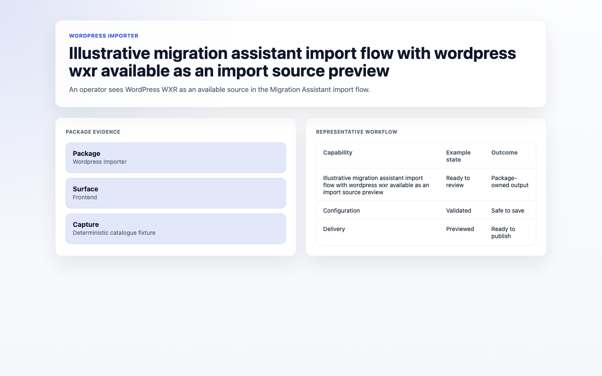
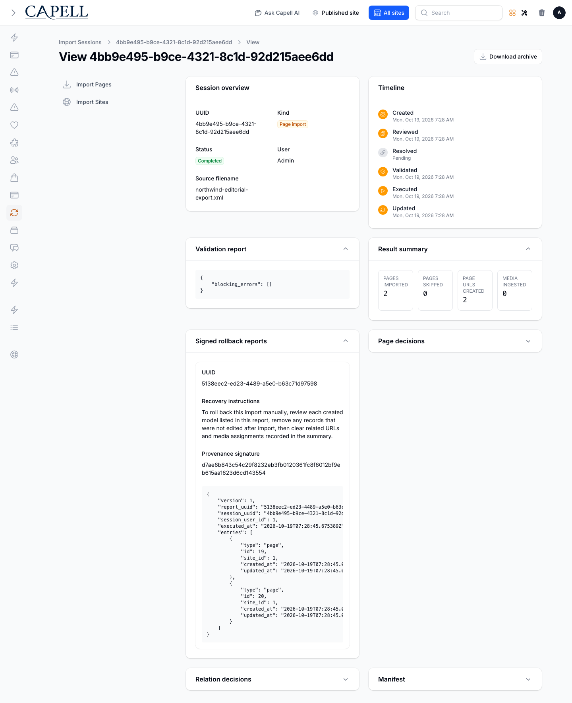

# Using WordPress Importer

This guide is for editors moving a site from WordPress and owners planning the migration. Every step uses the labels you see on screen. WordPress Importer runs inside Migration Assistant, so install that first.

## Using WordPress Importer (editor how-to)

### How to connect a WordPress export

1. Export your content from WordPress (a WordPress export file).
2. In Migration Assistant, start a new import and choose WordPress as the source.
3. Provide your WordPress export.

### How to review WordPress metadata

1. Preview the import.
2. Review the parsed title, body, date, categories, tags, author, permalink, and media references.
3. Use the preserved WordPress metadata to decide how imported content should be organised after import.

The command-line preview reports malformed page and post items separately from
already-imported skips. Its omission count covers every malformed item; the
diagnostic list is capped by `wordpress-importer.spool.max_stored_item_errors`.
Repair the listed items in WordPress, export again, and repeat the preview before
importing. JSON output includes the count and bounded diagnostics in
`omitted_items`.

### How to import posts and media

1. Preview the import to check the result. The preview lists the parsed posts and pages with their title, slug, status, date, categories, tags, and author.
2. Run the import to bring across posts, pages, and media.

### How to verify the import

1. Open the **Results**.
2. Confirm posts and pages came across, and spot-check a few on the site.
3. Check that images appear. For incomplete downloads in a retained session, give an authorised administrator the import reference and errors. They should repair reachability, the response at the stored media URL or the configured limits, then retry that same session. Retry uses stored URLs and checkpoints; it does not reload a changed export. A wrong source URL or corrected export needs a separate preview and recovery assessment.
4. Open the import session that Migration Assistant created to review the full record of what was imported.

## Rolling out WordPress Importer (for owners)

### Turn on first

- Migration Assistant, then a test import. Install Migration Assistant, back up, and import a few posts before bringing everything across.

### Add when needed

| Need                          | Enable                                                    |
| ----------------------------- | --------------------------------------------------------- |
| Move an entire WordPress site | A full import once a test batch looks right               |
| Keep your old structure       | Review preserved category and tag metadata before running |

### Don't enable yet

- Don't run the full import until a small test batch and its media verify correctly.

### Who does what

| Role       | First useful screen                            |
| ---------- | ---------------------------------------------- |
| Editor     | The WordPress import in Migration Assistant    |
| Site owner | **Results**: confirm the migration is complete |

## Troubleshooting for editors

| What you see                        | What it means                                       | What to do                                                     |
| ----------------------------------- | --------------------------------------------------- | -------------------------------------------------------------- |
| WordPress isn't offered as a source | Migration Assistant or the importer isn't installed | Install Migration Assistant first, then the WordPress Importer |
| Categories need follow-up           | Category hierarchy is not imported; terms are flat  | Arrange the imported terms in Capell                           |
| Images are missing                  | Media wasn't included or mapped                     | Confirm media is part of the export and re-import              |
| Some posts didn't import            | They were skipped due to errors                     | Review **Results** and re-import the affected posts            |

## Preserved metadata and recovery

Categories and tags become terms in a Categories and a Tags taxonomy on the target site, reusing any taxonomy or term that already exists. Each author is matched to an existing Capell user by the email in the export and recorded as the page's creator; an author with no matching user is listed in the import result and no account is ever created. Block-editor content is converted to plain HTML: block markers and layout wrappers go, embeds become a link to the original, and any block the importer cannot express is kept as its exported HTML and named in the page's WordPress details. The importer does not convert blocks into Layout Builder blocks. A re-import skips posts that already exist unless you ask for updates with `--update-fields=title,content,excerpt`. A requested field is updated only when the export changed it since the last import and nobody has edited it on the page since; a field an editor changed, and any page imported before the importer recorded what it stored, is left alone and listed in the result. The address and the publish state are never changed by a re-import. Each update is an ordinary page save, so the page's revision history holds the previous value.

An ordinary editor can pass on the import reference and visible errors. A global administrator with `import-session.view` retrieves the session and its reports; rollback execution is an authorised command-line operation. Follow [Migration Assistant recovery](../../migration-assistant/docs/overview.md#roll-back-created-records) for report inspection, a dry run and unchanged-record/manual-recovery limits.
